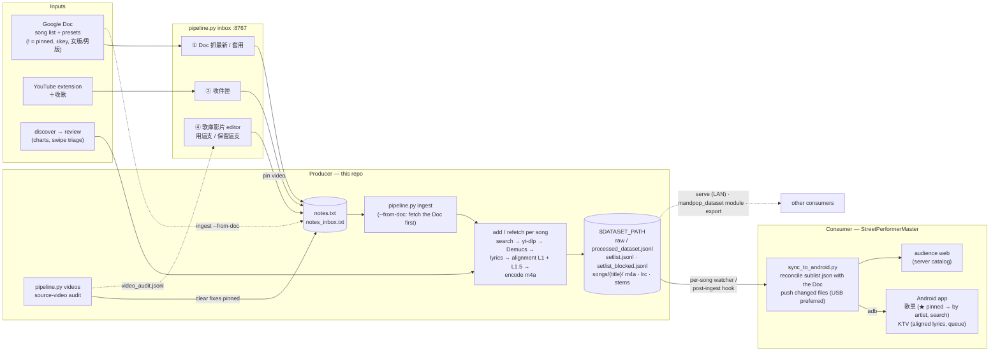

# MandpopDataPipeline

> **Two-part project. Personal today; structurally ready to become a public Mandarin-pop research dataset.**
> **Part 1 (current):** build a clean, alignment-verified Mandarin pop dataset by automating the whole flow from a song title to a playable instrumental with timestamped lyrics.
> **Part 2 (future):** use that dataset for audio modeling research — singing voice synthesis, vocal restoration, music restoration diffusion. See `RESEARCH_MODELING.md`.

This repo is the **data factory** — it produces data; consumer projects (a karaoke iOS app, a future vocal-studio tool) read it via the `mandpop_dataset` Python module. The dataset lives on disk at `$DATASET_PATH`; this repo holds the code that maintains it.

Code is MIT-licensed and the package is structured so any other Python project can install it (`pip install -e .` today; PyPI release is the obvious next step). Audio files are kept local-only by design — see the **Distribution & sharing** section for the AudioSet-style "recipes public, audio reproduced locally" plan.

### System overview



- **The Google Doc owns the performer's song list.** Every Doc line enters the research corpus and the setlist; `!` pins a song, `±N` / `女版`/`男版` are presets. Songs removed from the Doc leave the phone (manual picks stay).
- **Songs reach the phone one by one**: whenever a song finishes, `pipeline.py setlist` (read-only on raw) refreshes the setlist and `sync_to_android.py` pushes only changed files; the app polls its songs folder every 5 s and reloads without stopping playback.
- **Quality loops**: `pipeline.py videos` replaces clearly wrong source videos (live / cover / another singer) and lists judgement calls in the ④ editor; alignment Layer 1.5 re-times every lyric line so lyrics don't drift behind the singing.

---

## Part 1 — Building the dataset

### Summary

From one song title, `python pipeline.py add "歌名"` runs the full 6-step flow end-to-end, and the song only enters the **processed** (consumer-facing) dataset if every gate passes.

```
"歌名"
  │
  ▼
┌─[1] yt-dlp search ──────────┐  highest-view official MV (covers/karaoke filtered)
│                             │
├─[2] yt-dlp download ────────┤  → original.mp3
│                             │
├─[3] Demucs htdemucs_ft ─────┤  → vocals.wav + instrumental.wav
│                             │
├─[4] Lyrics fallback chain ──┤  NetEase → QQ → YouTube auto-subs
│                             │  → lyrics.lrc + lyrics.txt
│                             │  + artist / lyricist / composer / album
│                             │
├─[5] Alignment gate ─────────┤  Layer 1 VAD onset → Layer 1.5 per-line re-timing
│                             │  (+ Layer 2 WhisperX drift with `audit --layer2`)
│                             │  (auto-shift / re-time LRC, original kept as lyrics.lrc.orig)
│                             │
├─[6] Encode AAC 192k ────────┤  → instrumental.m4a
│                             │
└─→ promote to processed_dataset.jsonl iff alignment ∈ {ok, fixed}
                                     AND status=done AND lyrics=lrc AND m4a=true
```

Output for one song:

```
$DATASET_PATH/songs/{title}/
├── original.mp3         YouTube source audio (gitignored; dropped by compact)
├── instrumental.wav     Active lossless master (gitignored; → .flac after compact)
├── instrumental.m4a     192k AAC, what consumer apps load (gitignored, ~5 MB)
├── vocals.wav           Active vocals stem (gitignored; → .flac after compact)
├── lyrics.lrc           Timestamped, possibly auto-shifted
├── lyrics.lrc.orig      Pre-shift backup (only written when alignment shifted)
├── lyrics.txt           Plain text
├── metadata.json        YouTube info + artist / lyricist / composer / album
└── separations/         Optional A/B candidates from alternative separators
    └── {method}/        (e.g. bs_roformer/) — see `pipeline.py separate`
```

### Two datasets

The whole pipeline revolves around two JSONL indexes at `$DATASET_PATH`:

| File | Contents | Reader |
|------|----------|--------|
| `raw_dataset.jsonl` | Every crawled song, **including failures** (wrong YouTube version, mis-tagged LRC, alignment couldn't be auto-fixed). Carries internal pipeline state. | Pipeline housekeeping only. |
| `processed_dataset.jsonl` | Strict subset that passed every gate. Self-describing: title + full metadata + concrete file paths. | **Consumer apps, training datasets.** |

`processed ⊂ raw`. The processed file is regenerated automatically every time the raw catalog or any record's alignment verdict changes — they are never out of sync. Bug records (wrong-version, drift, misaligned) stay in `raw_dataset.jsonl` so we can still triage them.

`audit_report.jsonl` (also at `$DATASET_PATH`) is the per-song verdict detail from the most recent `audit` run.

#### Promotion criteria (`is_processed`)

Every clause must hold:

- `status == "done"` — Demucs separated, lyrics fetched
- `alignment ∈ {ok, fixed}` — Layer 1 + Layer 2 both passed (`fixed` = auto-shifted then re-verified)
- `lyrics == "lrc"` — has timestamps, not plain text only
- `m4a == True` — playable `instrumental.m4a` exists on disk

#### `processed_dataset.jsonl` entry schema

```json
{
  "title": "一葷一素",
  "artist": "毛不易",
  "lyricist": "毛不易",
  "composer": "毛不易",
  "album": "平凡的一天",
  "youtube_url": "https://www.youtube.com/watch?v=8DQYzIb2cX4",
  "files": {
    "instrumental": "songs/一葷一素/instrumental.m4a",
    "lyrics": "songs/一葷一素/lyrics.lrc"
  }
}
```

Paths are relative to `$DATASET_PATH`. Internal audit metrics are deliberately stripped — those live in `raw_dataset.jsonl` and `audit_report.jsonl`.

### Alignment gate (the heart of Part 1)

| Layer | Method | Cost | Catches |
|-------|--------|------|---------|
| **Layer 1** | RMS-based voice activity detection on `vocals.wav` ↔ first non-metadata LRC line. Auto-shifts the LRC by the measured offset. | seconds | YouTube intros, MV pre-rolls, voice-overs that aren't in the LRC's reference release |
| **Layer 1.5** | Per-line re-timing (`processors/lrc_align.py`): every LRC line start is assigned to a vocal onset of `vocals.wav` by dynamic programming — onset strength rewarded, gap ratios vs. the LRC penalized (relaxed across long breaks; an inserted/cut passage costs a flat penalty), a global `a·t + b` fit as a soft prior. Applied only when lines then land on onsets clearly more often. | ~1 s per song, CPU | Lyrics drifting further behind as the song goes: sped-up re-uploads (1–4 % tempo), MVs with a longer intro or an extra interlude |
| **Layer 2** | WhisperX ASR on `vocals.wav` → flat per-character time stream → substring-match each LRC line within a ±20 s window → median ± MAD drift | 3–5 s per song on GPU | Wrong YouTube version, wrong LRC release (e.g. 粵語 LRC vs 國語 MV), cover by another artist, sustained drift Layer 1 missed |

Layer 2 has a **second-pass auto-shift**: if it detects a tight large drift (median > 5 s, MAD < 4 s), the LRC is shifted by the signed median and re-verified. This rescues songs where Demucs left enough instrumental hum in `vocals.wav` to fool Layer 1 about where vocals actually start.

Verdicts (stored in each raw record's `alignment` field):

| Verdict | Meaning | Promotes? |
|---------|---------|-----------|
| `ok` | offset ≤ 0.5 s, no shift needed | ✅ |
| `fixed` | offset shifted (Layer 1 and/or Layer 2) and/or lines re-timed (Layer 1.5), then re-verified | ✅ |
| `fixable` | offset measured but auto-fix wasn't applied (`--no-fix` run) | ❌ |
| `drift` | Layer 2 found inconsistent drift even after auto-shift | ❌ |
| `misaligned` | Layer 1 offset > 30 s, or Layer 2 match rate < 6% | ❌ |
| `no_data` | missing files, or VAD couldn't find an onset | ❌ |

`lyrics.lrc.orig` is written before any auto-shift or re-timing, so every modification is reversible.
Layer 1 and 1.5 run in `add` (step 5/6), `refetch` and `pipeline.py audit`; on the 2026-10 library
a dry run re-timed 154 / 176 songs and raised the share of line starts followed by singing
(first second, vocals VAD) from 0.76 to 0.91, with no song getting worse.

### CLI reference

All commands run inside the project's `.venv` (or any environment with `requirements.txt` installed). Configure `DATASET_PATH` in `.env`.

#### Add songs to the raw dataset

```bash
python pipeline.py add "告白氣球"
python pipeline.py add "告白氣球" "小幸運" "演員"
python pipeline.py add "告白氣球" --url "https://youtube.com/watch?v=..."
python pipeline.py add --from songs.txt
python pipeline.py add --from songs.json
python pipeline.py add --from songs.txt --lyrics-only
python pipeline.py add "新歌" --device cpu
```

Supported `--from` formats:

| Format | Example |
|--------|---------|
| `.txt` | One title per line, `# comment` lines ignored. `title\tURL` to pin a YouTube URL. |
| `.json` | `{"songs": [{"title": "…"}]}` or `["title1", …]` |
| `.jsonl` | One `{"title": "…", "youtube_url": "…"}` per line |

#### Inspect dataset state

```bash
python pipeline.py status                       # raw / processed counts + alignment breakdown
python pipeline.py list                         # everything in raw, with status icons
python pipeline.py list --processed             # only the processed subset
python pipeline.py list --raw-only              # raw entries that did NOT promote
python pipeline.py list --missing-lyrics
python pipeline.py list --misaligned
python pipeline.py list --unchecked
```

`list` icons read as (status, lyrics kind, alignment, in-processed?):

```
  ♫ LRC ○ L  一葷一素     ok, in processed
  ♫ LRC ↻ L  K歌之王      auto-shifted, in processed
  ♫ LRC ~ ·  你不知道的事  drift, raw-only
  ♫ LRC ✗ ·  歐若拉       wrong-version, raw-only
```

#### Re-audit alignment

```bash
python pipeline.py audit                        # Layer 1 only, auto-fix on
python pipeline.py audit --layer2               # + WhisperX (~13 min on RTX 3070 for 150 songs)
python pipeline.py audit --no-fix               # report-only, don't modify any LRCs
python pipeline.py audit --only-processed       # re-verify the processed subset
python pipeline.py audit --only "歌1" "歌2"     # spot-check specific titles
```

Each run overwrites `audit_report.jsonl` and updates the `alignment` field on every audited record (automatically flipping `processed` membership).

#### Encode m4a (backfill)

```bash
python pipeline.py encode                       # any missing instrumental.m4a
python pipeline.py encode --bitrate 256k
python pipeline.py encode --overwrite
```

`add` already runs the encoder as step 6 — this is only needed when re-running on an old dataset that pre-dates the encode step.

#### Compact (shrink disk losslessly)

```bash
python pipeline.py compact --dry-run            # preview what would change
python pipeline.py compact                      # default: ~70% saving / song
python pipeline.py compact --aggressive         # also drop FLAC stems (~95% saving)
python pipeline.py compact --include-raw        # also compact raw-only entries
```

Per song the default compact:

- **Deletes** `original.mp3` (regeneratable from `youtube_url`)
- **Transcodes** `vocals.wav` + `instrumental.wav` to lossless FLAC (~43% of WAV size, bit-exact round-trip)
- **Keeps** `instrumental.m4a`, `vocals.flac`, `instrumental.flac`, `lyrics.lrc`, `lyrics.txt`, `metadata.json`

Stems remain available to downstream consumers (VocalStudio, re-Demucs, re-audit) — FLAC reads transparently in `soundfile` / `librosa` / `ffmpeg` / WhisperX. Use `--aggressive` only when you're sure nothing downstream needs stems anymore.

After compact, `pipeline.py audit` preserves the existing alignment verdict instead of demoting compacted songs to `no_data`.

#### Run alternative separators (A/B candidates)

```bash
python pipeline.py separate --list-methods                       # see available
python pipeline.py separate "告白氣球" --method bs_roformer       # one song
python pipeline.py separate --all --method bs_roformer           # background batch
python pipeline.py separate --status                             # method × song matrix
python pipeline.py separate --ab-page                            # exports/ab_compare.html listening page
python pipeline.py separate "小幸運" "倔強" --ab-page              # page for just these songs
python pipeline.py separate --review --methods karaoke_aufr33,karaoke_becruily,karaoke_gabox_v2 --segments 5
                                                                 # exports/ab_review.html: hotspots only, blind voting
```

| Method | Model | What `instrumental.*` contains |
|---|---|---|
| `htdemucs_ft` | Demucs htdemucs_ft (active baseline) | everything but vocals |
| `bs_roformer` | BS-RoFormer viperx ep317 | everything but vocals |
| `mel_band_roformer` | Mel-Band RoFormer Kim FT (unwa) | everything but vocals |
| `mdx23c` | MDX23C-8KFFT InstVoc HQ | everything but vocals |
| `inst_becruily` | Mel-Band RoFormer Instrumental (becruily) | everything but vocals (fullness-oriented) |
| `karaoke_aufr33` | Mel-Band RoFormer Karaoke (aufr33/viperx) | **backing vocals kept**, lead vocal removed |
| `karaoke_gabox_v2` | Mel-Band RoFormer Karaoke V2 (Gabox) | **backing vocals kept**, lead vocal removed |
| `karaoke_becruily` | Mel-Band RoFormer Karaoke (becruily) | **backing vocals kept**, lead vocal removed |

For `karaoke_*` methods `vocals.*` holds the lead vocal only. The `--ab-page` player switches sources at the same playback position (number keys 1–9) and has a blind mode that shuffles and hides method names; it references audio by relative path, so open it from disk.

**Hotspot review (`--review`)** — the fast path for picking a winner without listening to whole songs. `processors/ab_review.py` loudness-matches the candidate instrumentals, slides a 2 s window over their STFTs and, in two bands — *harmony* (200 Hz–5 kHz, lead-vs-backing decisions) and *detail* (5–16 kHz, cymbals / air / sibilant leakage) — finds the method furthest from the others (the "odd one out"), its distance (score, normalised by the song's median so ×3 = three times the typical disagreement) and whether it kept more or less energy. Near-silent windows are skipped; the top windows (≈60 % harmony / 40 % detail, non-overlapping) become 6 s looped segments. The page plays every option in lockstep and only flips muting, so switching is gapless; keys: `1`–`9` option, `0` original, `V` instrumental ⇄ vocal stem, `A`/`B`/`C`… vote, `S` tie, `←`/`→` segment. Names are hidden and shuffled per segment until you vote; votes persist in browser storage and export as JSON (`ab_review_votes.json`). 5 songs × 5 segments × 3 methods ≈ 8 minutes of listening.

The Phase 1 baseline is `htdemucs_ft` (2022). To evaluate newer separators (BS-RoFormer / Mel-Band RoFormer / MDX23C) without disturbing what consumer apps already read, candidate stems land in `songs/{title}/separations/{method}/` instead of the song root — the active stems are never touched. Source mix priority is `original.mp3` → re-download from `youtube_url` to a temp file (existing Demucs stems are **not** summed back in: feeding an already-separated mix to a new separator would bias the A/B).

Output defaults to lossless `.flac` (half the size of WAV). The alternative engines run through the `audio-separator` package. It needs numpy 2.x, which conflicts with transformers/WhisperX in the main env, so it lives in an isolated venv at `tools/venvs/separator/` (inherits the main env's torch via `--system-site-packages`, overrides numpy/numba locally). `processors/separate.py` calls it in a subprocess (`processors/_separator_worker.py`). `python setup_env.py` creates it; set `SEPARATOR_PYTHON` to use another interpreter.

Weights cache in `tools/models/audio-separator/` (gitignored, ~0.9–1.7 GB each). audio-separator downloads from GitHub Releases, which can be very slow (~50 KB/s observed); any file already present is used as-is, so you can pre-seed from a Hugging Face mirror with the identical filename and verify the sha256 against the HF LFS oid. Delete partial files after an interrupted download — a truncated `.ckpt` is treated as present.

Weight licensing: these community weights are free to download but mostly carry no explicit license. Fine for personal/research use; they are never redistributed (see `docs/RELEASE_SPEC.md`).

No promotion / rollback flow yet — that comes after the listening pass picks a winner.

#### Backfill artist / lyricist / composer / album

```bash
python pipeline.py enrich                       # LRC + YouTube title + (NetEase / QQ API)
python pipeline.py enrich --no-api              # offline mode, LRC + YouTube title only
python pipeline.py enrich --force               # overwrite even already-populated fields
```

Source priority: LRC headers/credit lines → YouTube title (most reliable for official MVs) → NetEase/QQ API (last resort, returns covers when the original artist's catalog is pulled). `add` runs the same enrichment automatically for new songs.

#### Ingest daily notes (notes.txt → corpus + setlist)

```bash
python pipeline.py ingest                       # full run: add missing songs + update setlist
python pipeline.py ingest --dry-run             # parse + report only, write nothing
python pipeline.py ingest --no-add              # update presets/setlist, skip downloading new songs
python pipeline.py ingest --file other.txt      # alternate notes file
python pipeline.py ingest --from-doc            # fetch the tracked Google Doc → notes.txt → ingest → post-ingest hook
python pipeline.py ingest --from-doc URL        # same, and make URL the tracked doc
python pipeline.py ingest --from-doc --dry-run  # show the Doc diff only
python pipeline.py ingest --from-doc --no-then  # skip INBOX_POST_INGEST_CMD (no phone sync)
python pipeline.py setlist                      # rewrite setlist.jsonl from notes + current raw only
```

`setlist` touches nothing but `setlist.jsonl` / `setlist_blocked.jsonl` and only
reads `raw_dataset.jsonl` (twice, retrying until both reads agree), so it is
safe while an ingest is running. Run it with the phone sync after each song
finishes to publish songs one by one instead of when the whole batch ends
(prints `setlist.jsonl: 158 ready, 78 not yet`).

`--from-doc` is the unattended version of the inbox page's 「抓最新」+「套用」:
it prints the Doc diff (`Google Doc: 236 songs — +13 −7 ~20 vs notes.txt`),
writes `notes.txt` (previous copy → `notes.txt.bak`), runs `ingest`, then runs
`INBOX_POST_INGEST_CMD` (e.g. the StreetPerformerMaster phone sync). If the
fetch fails it exits 1 and leaves `notes.txt` untouched. The tracked doc is
`NOTES_DOC_URL` from `.env`, else the link saved in `inbox_config.json`
(by the inbox page or a previous `--from-doc URL`). The Doc must be shared as
*anyone with the link can view*. To sync nightly on Windows:

```powershell
schtasks /Create /TN "MandpopDocSync" /SC DAILY /ST 04:00 /TR "cmd /c cd /d D:\MandpopDataset && python pipeline.py ingest --from-doc >> doc_sync.log 2>&1"
```

Paste your Google Doc into `notes.txt` (grammar in the **Daily note-taking
convention** section), run `ingest`, and: every song enters the research
corpus (auto-`add`), marked songs get key/gender/favorite presets written to
`metadata.json`, guide-vocal `vocals.m4a` files are encoded, and
`setlist.jsonl` is regenerated. The report lists songs that are still blocked
(misaligned / missing lyrics) and why.

`ingest` also folds in `notes_inbox.txt` (songs saved from YouTube by the
browser extension, below), re-queues discovered titles still `pending` in raw,
and **refetches** a done song when its line pins a different YouTube video
than the one downloaded (that's how "use THIS version" works).

Doc lines are treated as **exact song names**: without a URL, a video is only
used when a name slot of its title (`《X》`, `【X】`, `[X]`, ` - X`, …) equals
the title (simplified/traditional-insensitive), preferring official studio
uploads over live / talent-show clips. Titles with no such video are not
downloaded; the end of the ingest log lists them as probable typos with the
top hits. Same-name songs by different artists need `／歌手` or a URL.
If every download fails with `HTTP Error 403`, YouTube has outpaced the
installed yt-dlp: `pip install -U yt-dlp`.

#### Song inbox (Google Doc + YouTube extension → ingest)

```bash
python pipeline.py inbox                        # http://127.0.0.1:8767
python pipeline.py inbox --then "CMD"           # run CMD after each successful ingest
python pipeline.py inbox --port 8769 --edit-only  # second page that saves edits but never starts ingest
```

One local page for both intake paths; every change runs `ingest` in the
background (single-flight — requests during a run coalesce into one re-run)
with a live log:

- **Google Doc** — paste the whole doc, or save its link once and press
  「抓最新」 (the doc must be shared as *anyone with the link can view*; the
  link is stored in gitignored `inbox_config.json`). A diff against
  `notes.txt` (added / changed / removed, and which songs need downloading)
  is shown before 「套用」 writes `notes.txt` (previous copy → `notes.txt.bak`).
- **YouTube** — load `tools/youtube_inbox_extension/` via
  `chrome://extensions` → Developer mode → *Load unpacked*. On a watch page,
  「＋ 收歌」 opens a panel prefilled from the video title (title / artist,
  matched against corpus titles via `GET /api/guess`; key and 女/男 hints
  such as 「降3key」). The key stepper is the **playback preset relative to
  this video** — if the video itself is already shifted (a 降key KTV
  version), the downloaded instrumental is already in that key, so leave it
  at 0. Saving upserts one line into `notes_inbox.txt`.

Precedence: the Google Doc wins wherever it says something about a title —
its markers beat the inbox's, but a Doc line without markers takes the
inbox's, and a Doc line without a URL takes the inbox's pinned video.
Conflicts are reported in the ingest log; copy the inbox line into the Doc
to make it permanent.

`--then` (or `INBOX_POST_INGEST_CMD` in `.env`) is how a consumer gets
refreshed without the producer importing it — e.g. StreetPerformerMaster's
phone sync. The child process gets an absolute `DATASET_PATH`.

#### Karaoke backing tracks, queue control and machine load

```bash
python pipeline.py karaoke                      # every processed song → lead removed, backing vocals kept
python pipeline.py karaoke 小幸運 演員          # only these songs
python pipeline.py karaoke --method karaoke_aufr33 小幸運   # another karaoke separator
python pipeline.py karaoke --revert 小幸運      # back to the htdemucs_ft backing
python pipeline.py queue pause                  # stop long batches after the song in progress (frees the GPU)
python pipeline.py queue resume                 # carry on where they stopped
python pipeline.py queue status
```

`karaoke` runs the karaoke separator (default `karaoke_becruily`, the blind-test
winner) into `separations/{method}/`, backs up the current `instrumental.m4a` /
`vocals.m4a` once into `separations/htdemucs_ft/`, then encodes the karaoke
instrumental as `instrumental.m4a` and its lead-vocal stem as the guide
`vocals.m4a`. The lossless htdemucs_ft stems at the song root stay as they are:
the alignment gate and research consumers keep using them. `metadata.json`
(`instrumental_method`, `guide_vocal_method`, `karaoke_promoted_at`) and raw
(`instrumental_method`) record which separator each song uses; songs already
on the method are skipped. The phone picks the new files up on the next sync
(audio is compared by size).

Pausing is a flag file (`$DATASET_PATH/.queue_paused`) checked between songs by
`karaoke`, `separate`, and the add / refetch loops of `ingest`; the song in
progress finishes first (a few minutes on an RTX 3070). Set
`MANDPOP_IGNORE_PAUSE=1` on one command to run it while the others are held.

Every pipeline command runs at below-normal CPU priority with math-library
thread pools capped at a quarter of the logical cores (`processors/resources.py`),
inherited by the separator / Demucs / ffmpeg children, so the desktop stays
responsive. `MANDPOP_THREADS=N` changes the cap; `MANDPOP_PRIORITY=normal`
turns both off. Measured on a karaoke run: the pipeline process tree averaged
5 % of the machine's CPU (peak 8 %) and 2.4 GB RAM. Antivirus scanning and
search indexing of the freshly written audio files can cost more than that; add
`$DATASET_PATH` to their exclusions if the PC feels slow during a batch.

#### Fix source videos (audit + library editor)

```bash
python pipeline.py videos                    # audit every done song; pin clear fixes
python pipeline.py videos 故事 楓            # only these songs (always re-checked)
python pipeline.py videos --dry-run          # report only, pin nothing
python pipeline.py videos --max-age 0        # re-check everything (default reuses rows < 7 days old)
python pipeline.py videos --reclassify       # re-judge stored rows with the current rules (no network)
python pipeline.py ingest                    # refetch the pinned songs
```

Many early songs were built from a live, talent-show, cover or lyric-video
upload. `videos` compares each song's current video with a fresh search
(`title artist` and `title 官方 MV`) and writes `video_audit.jsonl`:

| Verdict | Meaning | Action |
|---|---|---|
| `ok` | current video is the best candidate, or about as popular | none |
| `auto` | current upload is live / cover / KTV / another singer's version / unavailable, and the best candidate is an official studio upload by the credited artist (with ≥ 3× the views, or ours is another singer's) | pinned in `notes_inbox.txt` |
| `suggest` | a better upload probably exists but it's a judgement call (unknown artist, same-name songs, a clean upload with fewer views) | review in the editor |
| `pinned` | the Doc or the inbox already pins a URL | never touched |

"Best candidate" = an upload whose title names the song, studio before live,
official before fan, then most views. "Official" = the title says so
(`Official`/`官方`/`MV`) or the channel is a YouTube Music `Artist - Topic`
channel (the album master — the cleanest separation source). Output ends with
`video_audit.jsonl: auto 12, ok 120, suggest 40` and the auto replacements.

**Library editor** — `pipeline.py inbox` → ④ 歌庫影片 lists every done song
with its current video (thumbnail, channel, views) and up to five
candidates. 「用這支」 (or a pasted URL) pins the video in `notes_inbox.txt`
and starts `ingest`, which re-downloads, re-separates and re-aligns the song,
then runs the post-ingest hook (phone sync). 「保留這支」 on the current video
confirms it (pins the same URL: no refetch, never flagged again).
「重新搜尋」 re-audits one song. The server never runs two ingests at once:
it waits while another `pipeline.py ingest` process is running.
Filters: 待確認 (`suggest`) / 已自動換 / 已指定 / 沒問題 / 全部. A Doc line
with its own URL still wins over a pin made here.

#### Review discovered songs (swipe triage)

```bash
python pipeline.py discover --era all --add -o discovered.txt   # ① register candidates as pending
python pipeline.py review                                       # ② open http://127.0.0.1:8766
python pipeline.py add --accepted                               # ③ process what you accepted
```

`review` opens a swipe UI that walks the pending queue one song at a time
with an embedded YouTube preview (top filtered search hit, prefetched a few
songs ahead):

| Key | Action |
|---|---|
| `→` | accept — queued for `add --accepted` |
| `←` | reject — stays in raw with `review=rejected`, never processed |
| `↓` | skip — decide later |
| `U` / `Backspace` | undo the previous verdict |

The previewed video's URL is cached into the record, so **the video you
heard is exactly the video `add --accepted` downloads**. Don't run `review`
while a `discover --add` registration is still writing — one writer at a time.

`review` 是人工快篩關卡：發掘進來的候選歌一首首過，聽個幾秒按方向鍵決定
要不要收。接受的歌之後用 `add --accepted` 批次處理；你試聽的那支影片
就是實際會下載的版本。

#### Serve the dataset on the LAN (Mac on-demand fetch)

```bash
python pipeline.py serve                        # http://0.0.0.0:8765
python pipeline.py serve --port 9000
```

Read-only single-page web UI + JSON API for devices that must not mirror the
dataset. **The Mac does NOT clone this repo** — it only needs a browser:
open `http://<windows-ip>:8765/`, search a song, download its FLAC stems +
lyrics (~50 MB), record. API endpoints are documented in the
**Architecture** section (interface ②).

#### Record popularity metrics (YT time series)

```bash
python pipeline.py metrics                      # snapshot every song with a youtube_url
python pipeline.py metrics --processed-only
python pipeline.py metrics --only "演員" "聽海"
```

Appends one `{ts, source, video_id, views, likes, comments}` line per song to
`songs/{title}/metrics.jsonl`. Append-only — run it weekly (a scheduled task
is ideal) and the popularity time series accumulates by itself.

#### Compute audio features

```bash
python pipeline.py features                     # every processed song missing features.json
python pipeline.py features --overwrite         # recompute (e.g. after an extractor upgrade)
python pipeline.py features --only "演員"
```

Computes `features.json` (BPM / key / LUFS / energy / vocal ratio / sections)
locally from the stems — requires `librosa`. Known v1 caveats: beat tracking
sometimes reports double-time BPM for slow ballads, and the key estimator can
confuse relative major/minor pairs (e.g. B major vs G# minor); section labels
are heuristic.

#### Other commands

```bash
python pipeline.py lyrics                       # crawl lyrics for songs missing them
python pipeline.py sync                         # rebuild raw_dataset.jsonl from songs/ on disk
python pipeline.py export --request req.json --output ./export
```

`export` only emits the processed subset by default. Add `"include_raw": true` to the request JSON to bypass the gate (diagnostic dumps only — never ship raw entries to a consumer app).

### Lyrics fallback chain

| Source | Format | Coverage | Notes |
|--------|--------|----------|-------|
| **NetEase Cloud Music** | LRC | ~95% of Mandarin pop | Primary. Free API, well-tagged. |
| **QQ Music** | LRC | Fills NetEase gaps, especially Jay Chou (NetEase pulled his catalog in 2018) | Secondary. |
| **YouTube auto-subs** | LRC (ASR-quality) | 100% but unreliable | Last resort, low quality. |

After download both `lyrics.lrc` (timestamped) and `lyrics.txt` (plain) are stored.

The search uses the song's singer (the Doc's `【歌手】` heading, or `X版`). A hit
by that singer wins over an earlier source's hit by someone else: NetEase's
exact-title match is often a cover or a different song with the same title
(迷迭香 came back as 張宇's song, 說了再見 as a cover), while QQ has the
original. The singer is also what `metadata.json` / raw record `artist`
stores; the lyrics site's credit no longer overrides it.

Re-fetching a song onto another video (`refetch`, or a changed pin picked up
by `ingest`) deletes the old audio **and** `separations/`, so the karaoke
batch separates the new recording instead of reusing stale stems.

Search details that keep the right version:

- **Several queries per source.** Each source is tried with `title artist`,
  `title`, then the simplified-Chinese title with and without the artist.
  The first hit is kept as a fallback, but the search keeps going until a hit
  credits the singer (a throttled first query no longer settles for another
  artist's same-title song).
- **Variant characters match.** Titles and artist names are compared after
  conversion to simplified Chinese, so 艷/豔 or 演員/演员 count as the same.
- **QQ throttling is retried.** QQ answers `code 2001` with an empty list when
  it rate-limits; the search waits and retries up to 3 times (`QQ_RETRIES`,
  `QQ_BACKOFF_SEC` in `crawlers/lyrics.py`).
- **Repeated choruses keep their text.** Some QQ LRCs list a repeated line as
  a bare timestamp dated earlier than the previous line; those blanks get the
  previous line's text back (`fill_backdated_blanks`), so the karaoke screen
  doesn't go empty in the second chorus.
- **Doc songs that were never downloaded are added.** `ingest` adds every Doc
  song whose record has no `status` or is `pending` (`needs_add`), including
  records that only held setlist presets.

### Part 1 status

| Check | State |
|-------|-------|
| `pipeline.py add` runs all 6 steps end-to-end | ✅ |
| Alignment gate (Layer 1 VAD + Layer 2 WhisperX, both with auto-shift) | ✅ |
| `is_processed` strict gate enforced everywhere | ✅ |
| Failed songs stay in raw, excluded from processed and from `export` | ✅ |
| `instrumental.m4a` produced for every entry | ✅ |
| Artist / lyricist / composer / album auto-filled | ✅ |
| Catalog statistics on `pipeline.py status` | ✅ |
| Triage of remaining wrong-version / wrong-LRC cases | ⏳ in progress |

Run `python pipeline.py status` for the live numbers.

---

## Architecture: producer–consumer — 資料流架構規範

This project is the **single producer** in a hub-and-spoke producer–consumer
architecture. The dataset on disk is the hub; every app (street-performance
iOS app, Mac recording, future tools) is a **read-only consumer** attached
through one of four standardized interfaces. This section is the normative
spec for all data flows in and out.

本專案是 hub-and-spoke producer–consumer 架構裡的**唯一 producer**。磁碟上的
資料集是 hub；每個 app 端（街唱 iOS app、Mac 錄音、未來工具）都是透過四種
標準介面之一接上來的**唯讀 consumer**。本章是所有資料進出流的正式規範。

```
 INPUTS 進口 (how data gets in)          FACTORY 工廠 (this repo)            OUTPUTS 出口 (how consumers read)
 ──────────────────────────────         ─────────────────────────           ─────────────────────────────────
 notes.txt ──ingest──────────┐          ┌─────────────────────────┐
   (Google Doc 聽歌筆記)      │          │ add: yt-dlp → Demucs →  │    ①同磁碟 same-disk ($DATASET_PATH)
                             │          │      lyrics → alignment │──────► StreetPerformerMaster (iOS 街唱)
 discover → review ──────────┤          │      gate → encode m4a  │         instrumental.m4a + lyrics.lrc
   (排行榜 → 人工快篩 swipe)   ├────────► │                         │         + setlist.jsonl (key 預設)
                             │          │ state 狀態:              │
 add / add --from ───────────┤          │  raw_dataset.jsonl      │    ②HTTP (pipeline.py serve, LAN)
   (CLI 手動/批次)            │          │  processed_dataset.jsonl│──────► Mac recording 錄音 (→VocalStudio)
                             │          │  setlist.jsonl          │         vocals.flac + instrumental.flac
 metrics crawler ────────────┤          │                         │         + lyrics.lrc（單首按需拉）
   (scheduled YT stats 排程)  │          │ enrichment 加值:         │
                             │          │  metrics.jsonl (時間序列)│    ③Python (mandpop_dataset module)
 features extractor ─────────┘          │  features.json (音樂屬性)│──────► research / Phase 2 training
   (local audio analysis)               └─────────────────────────┘         全部 processed + features + metrics
                                                                 │
                                                                 │    ④bundle (pipeline.py export)
                                                                 └──────► offline snapshot 離線快照
```

### Interface matrix 介面規格矩陣

| # | Interface 介面 | Consumer 消費端 | Transport 傳輸 | Files 檔案 | Subset 可見範圍 |
|---|---|---|---|---|---|
| ① | **Same-disk 同磁碟** | StreetPerformerMaster（iOS 街唱 app 開發環境） | Both repos point at `$DATASET_PATH` via `.env`; no cloning 兩專案 `.env` 指同一資料夾，不 clone | `instrumental.m4a`, `lyrics.lrc`, `setlist.jsonl` | setlist（karaoke-ready only） |
| ② | **HTTP on-demand 按需拉取** | Mac 錄音（未來 VocalStudio） | `pipeline.py serve` on LAN, browser web UI + JSON API — fetch **one song at a time**, never mirror 一次拉一首，絕不整包鏡像 | `instrumental.flac`, `vocals.flac`, `lyrics.lrc`（+ m4a 可選） | processed |
| ③ | **Python reader** | research code, Phase 2 training 研究/訓練程式 | `pip install -e .` → `from mandpop_dataset import Dataset` | everything processed + `features.json` + `metrics.jsonl` | processed |
| ④ | **Export bundle 匯出包** | offline handoff, debugging 離線交付/除錯 | `pipeline.py export --request req.json --output dir` | per request JSON 依請求檔 | processed（`include_raw` 僅除錯） |

### `pipeline.py serve` API (interface ② spec)

```
GET /                          single-page web UI 網頁選歌介面
                               (search 搜尋 / setlist key 標記 / per-file download links)
GET /api/songs                 JSON list: all processed songs + setlist annotations
GET /api/songs/{title}         one song: metadata + which files exist on disk
GET /files/{title}/{kind}      kind ∈ instrumental.flac | vocals.flac |
                               instrumental.m4a | vocals.m4a | lyrics.lrc
```

- **The consumer machine needs NOTHING installed** — no repo clone, no
  Python, no git. A browser (or `curl`) is the entire client. On the Mac:
  open `http://<windows-ip>:8765/`, search, download, record.
  **消費端機器什麼都不用裝**——不 clone repo、不裝 Python、不碰 git。
  瀏覽器（或 `curl`）就是完整的 client。Mac 上開
  `http://<windows-ip>:8765/`，搜尋 → 下載 → 錄音。
- Binds LAN (`0.0.0.0:8765` default); **read-only by construction** — no
  mutating endpoint exists. 綁 LAN、**天生唯讀**——不存在任何會寫入的 endpoint。
- Serves the processed subset only; raw/misaligned songs are invisible.
  只吐 processed 子集；raw/對齊失敗的歌完全不可見。
- FLAC served from disk as-is (already the compacted steady state).
  FLAC 直接從磁碟原樣送出（compact 後的常態格式）。
- Supports HTTP Range requests, so the web UI's in-browser preview (▶ 試聽)
  can seek without downloading the whole file. 支援 Range 請求，網頁試聽可以
  直接拖進度條。

### Contract rules 合約規則（所有介面一體適用）

1. **Single writer 唯一寫入者** — only the pipeline in this repo ever writes
   under `$DATASET_PATH`. Every consumer interface is read-only; a consumer
   never mutates the dataset, never writes back through an interface.
   只有本 repo 的 pipeline 會寫 `$DATASET_PATH`。所有 consumer 介面一律唯讀；
   消費端絕不改動資料集、絕不透過介面回寫。
2. **Gate rule 閘門規則** — consumers only ever see the processed subset (or
   the setlist view of it). `raw_dataset.jsonl` and audit internals never
   cross an interface. 消費端永遠只看得到 processed 子集（或其 setlist 視圖）。
   `raw_dataset.jsonl` 與 audit 內部指標永不跨出介面。
3. **Path convention 路徑慣例** — every file reference in every consumer-facing
   index is relative to `$DATASET_PATH`. 所有消費端索引裡的檔案路徑一律相對於
   `$DATASET_PATH`。
4. **No audio through git 音訊不走 git** — GitHub carries code + text
   (LRC/metadata/indexes) only. Audio moves exclusively through interfaces
   ①②④ or is regenerated locally by re-running the pipeline.
   GitHub 只承載程式碼+文字（歌詞/metadata/索引）。音訊只透過介面 ①②④ 流動，
   或由重跑 pipeline 在本地重新生成。
5. **On-demand, never mirror 按需、絕不鏡像** — remote consumers fetch
   per-song. The dataset is too large to clone and is designed never to need
   it. 遠端消費端一次拉一首。資料集大到不該 clone，架構上也設計成永遠不需要。
6. **Schema versioning 格式版本化** — consumer-facing schemas
   (`processed_dataset.jsonl`, `setlist.jsonl`, serve API) are append-only:
   adding fields is free, removing/renaming requires a version bump announced
   in this README. 消費端 schema 只增不刪：加欄位隨時可以，刪改欄位必須升版
   並在本 README 公告。
7. **Future reverse flow 未來的回流** — consumer-produced artifacts (e.g. Mac
   vocal recordings) do NOT write into the dataset through any consumer
   interface. If recordings later become training data, they enter as a new
   **producer input** (a spec'd inbox + validation gate), same as `notes.txt`.
   消費端產物（例如 Mac 錄的人聲）不得經由任何 consumer 介面寫入資料集。若日後
   錄音要當訓練資料，須以新的 **producer 進口**（規範化的 inbox + 驗證 gate）
   進來，跟 `notes.txt` 同等地位。

---

## Data model & format specifications — 資料模型與格式規範

The project maintains **two decoupled data layers**. Everything below is the
normative spec — data collection and processing must follow these formats.

本專案的資料分成**兩個解耦的層**。以下是正式規範——之後所有的資料收集與處理都照這份格式走。

**Layer 1 is the point of this project; Layer 2 is an auxiliary convenience.**
The research corpus grows continuously and indiscriminately (any classic
Mandopop song qualifies — singability is irrelevant); the performance setlist
is just a thin curated view carved out of it for the karaoke app.

**Layer 1 才是本專案的重點；Layer 2 只是附加功能。**
研究資料集持續、不挑歌地擴充（任何華語流行經典都收——會不會唱無關緊要）；
表演歌單只是從中切出來、給點歌 app 用的一層薄薄的 curated view。

```
┌─ Layer 1: Research corpus 研究資料集 ── PRIMARY 主體 ─────────────┐
│  raw_dataset.jsonl / processed_dataset.jsonl                     │
│  + metrics.jsonl (popularity time series 熱度時間序列)             │
│  + features.json (audio features 音樂屬性)                        │
│  Purpose 目的: structural research on classic Mandopop            │
│               華語流行經典歌研究                                    │
│  Membership 收錄標準: any verifiable Mandopop song 不限會不會唱      │
│  Growth 擴充: continuous — discover / charts / daily notes         │
└──────────────────────────────────────────────────────────────────┘
                       │ thin curated view 薄薄一層人工挑選的視圖
                       ▼
┌─ Layer 2: Performance setlist 表演歌單 ── AUXILIARY 附加 ──────────┐
│  notes.txt   (Google Doc mirror, human-edited source of truth)     │
│  setlist.jsonl (generated, consumed by the karaoke app 產出給 app)  │
│  Purpose 目的: songs the maintainer performs 只收會唱的歌            │
│  Carries 附帶: key_offset / gender_variant / favorite               │
│              + karaoke-ready files 伴唱與導唱檔                      │
└──────────────────────────────────────────────────────────────────┘
```

Every song noted anywhere lands in the research corpus; the extra
performance markers (key / gender / `!` / `唱`) additionally place it in the
setlist. Removing a song from the setlist never removes it from the corpus.

任何被記下來的歌都會進研究資料集；有表演標記（key／性別／`!`／`唱`）的歌**額外**進
setlist。從 setlist 移除一首歌，永遠不會把它從研究資料集移除。

### Glossary — 名詞定義

| Term 名詞 | Definition 定義 |
|---|---|
| **Research corpus 研究資料集** | The union of `raw_dataset.jsonl` + `processed_dataset.jsonl`. Grows without limit via `add` / `discover`; a song's singability is irrelevant.<br>`raw_dataset.jsonl` 加 `processed_dataset.jsonl` 的總稱。透過 `add` / `discover` 無上限擴充，收不收錄跟「會不會唱」無關。 |
| **Setlist 表演歌單** | The curated subset of songs the maintainer actually performs, with personal presets. Source of truth is `notes.txt` (the Google Doc mirror); the app reads generated `setlist.jsonl`. Auxiliary to the research corpus.<br>維護者實際會表演的歌的人工挑選子集，帶個人預設。唯一來源是 `notes.txt`（Google Doc 鏡像）；app 讀產出的 `setlist.jsonl`。相對研究資料集只是附加功能。 |
| **key_offset 升降 key** | Signed semitone transposition to apply at performance time, e.g. `-2` = sing two semitones below the original key. Range typically −6…+6. `0` = original key.<br>表演時要套用的移調量（半音，含正負號），例如 `-2` = 比原曲低兩個半音唱。一般在 −6…+6 之間，`0` = 原調。 |
| **gender_variant 性別版本** | Which gendered arrangement the preset targets: `female` (女版) / `male` (男版) / `null` (original 原版).<br>預設對應哪個性別版本：`female`（女版）/ `male`（男版）/ `null`（原版）。 |
| **favorite 最愛** | Priority flag (`!` in `notes.txt`) — highlighted in the app's song menu.<br>優先標記（在 `notes.txt` 裡寫 `!`）——app 選單中置頂/強調顯示。 |
| **Accompaniment 伴唱** | The vocal-removed backing track: `instrumental.m4a` (AAC 192k) produced from the Demucs instrumental stem. What the app plays while the user sings.<br>去人聲伴奏：由 Demucs instrumental stem 編碼成的 `instrumental.m4a`（AAC 192k）。使用者唱歌時 app 播的音軌。 |
| **Guide vocal 導唱** | The isolated original vocal: `vocals.m4a` encoded from the Demucs vocals stem. The app can mix it in at low volume so the user can follow the melody.<br>分離出的原唱人聲：由 Demucs vocals stem 編碼成的 `vocals.m4a`。app 可低音量疊進伴奏，讓使用者跟旋律。 |
| **karaoke-ready** | A song that passed the alignment gate AND has `instrumental.m4a` + `lyrics.lrc` on disk (guide vocal optional). Only karaoke-ready songs enter `setlist.jsonl`.<br>通過 alignment gate 且磁碟上有 `instrumental.m4a` + `lyrics.lrc` 的歌（導唱檔可選）。只有 karaoke-ready 的歌會進 `setlist.jsonl`。 |
| **Metrics 熱度時間序列** | Periodically re-crawled web statistics (YouTube views / likes / comments), appended per crawl to `metrics.jsonl` — turning one-off snapshots into a time series that captures how popularity evolves.<br>定期重抓的網路數據（YouTube 點閱/讚/留言數），每次抓取 append 一列到 `metrics.jsonl`——把單次快照變成時間序列，記錄熱度如何演變。 |
| **Audio features 音樂屬性** | Quantitative features computed locally from the separated stems (BPM, musical key, loudness, energy, vocal ratio, section boundaries…), stored in `features.json`.<br>從已分離的 stems 本地計算出的量化特徵（BPM、調性、響度、能量、人聲佔比、段落邊界⋯），存在 `features.json`。 |
| **Provenance 發掘來源** | Where/when a song was discovered (which chart or playlist, rank, crawl date) — recorded so platform-level popularity dynamics can be studied later.<br>一首歌是從哪裡、何時被發掘的（哪個榜單/歌單、名次、抓取日）——記錄下來供日後研究平台間的流行動態。 |

### Layer 1 — Research corpus formats 研究資料集格式

#### `raw_dataset.jsonl` (existing 現行)

One JSON object per line, one per song ever added. Pipeline-internal state.
每行一個 JSON 物件、每首被 `add` 過的歌一筆。屬於 pipeline 內部狀態。

```json
{
  "title": "聽海",
  "added_at": "2026-04-24T17:00:56Z",
  "status": "done",                  // pending | done
  "lyrics": "lrc",                   // lrc | txt | none
  "youtube_url": "https://www.youtube.com/watch?v=...",
  "alignment": "ok",                 // ok | fixed | fixable | drift | misaligned | no_data
  "m4a": true,
  "processed": true,                 // = passed every promotion clause
  "artist": "張惠妹", "lyricist": "林秋離", "composer": "涂惠源", "album": "Bad Boy",
  "discovered_from": [               // provenance — appended by `discover` (spec)
    {"provider": "netease", "kind": "playlist", "name": "2000s華語金曲", "rank": 12, "seen_at": "2026-07-05"}
  ]
}
```

#### `processed_dataset.jsonl` (existing 現行)

Consumer-facing strict subset — schema documented in
[Part 1 → Two datasets](#two-datasets). Unchanged by this spec.
消費者讀的嚴格子集——schema 見上方 Part 1 章節，本規範不改動它。

#### `songs/{title}/metrics.jsonl` (spec 規範 — collected by `pipeline.py metrics`)

**Append-only** popularity time series. One line per crawl per source.
Never rewrite or dedup old lines — history is the point.
**只增不改**的熱度時間序列。每次抓取、每個來源一行。永不改寫舊行——歷史本身就是價值。

```json
{"ts": "2026-07-05T00:00:00Z", "source": "youtube", "video_id": "XaN3kUz4KSw", "views": 9329190, "likes": 41200, "comments": 3100}
{"ts": "2026-07-12T00:00:00Z", "source": "youtube", "video_id": "XaN3kUz4KSw", "views": 9411050, "likes": 41377, "comments": 3129}
```

| Field | Required | Meaning 意義 |
|---|---|---|
| `ts` | ✅ | Crawl timestamp, ISO-8601 UTC 抓取時間 |
| `source` | ✅ | `youtube` (future: `netease`, `spotify`, …) 數據來源 |
| `video_id` | ✅ for youtube | Which video the numbers belong to (MV re-uploads happen) 對應哪支影片 |
| `views` / `likes` / `comments` | ≥1 | Raw counts; `null` if the platform hides one 原始數字，平台不顯示則為 `null` |

Cadence 抓取頻率: weekly by default 預設每週一次（scheduled run 排程執行）。

#### `songs/{title}/features.json` (spec 規範 — computed by `pipeline.py features`)

One JSON document per song, recomputed wholesale when the extractor version bumps.
每首歌一份 JSON，抽取器版本升級時整份重算。

```json
{
  "version": 1,
  "computed_at": "2026-07-05T00:00:00Z",
  "source": {"vocals": "vocals.flac", "instrumental": "instrumental.flac"},

  "bpm": 72.5,                       // tempo 速度
  "key": "F#", "mode": "minor",      // original musical key 原曲調性
  "key_confidence": 0.87,
  "loudness_lufs": -9.3,             // integrated loudness 整體響度
  "energy": 0.71,                    // 0–1 normalized RMS energy 能量
  "dynamic_range_db": 8.2,           // arrangement dynamics 編曲動態範圍
  "vocal_ratio": 0.43,               // vocals-stem energy / total 人聲能量佔比

  "sections": [                      // structure segmentation 段落結構
    {"label": "intro",  "start_sec": 0.0},
    {"label": "verse",  "start_sec": 14.2},
    {"label": "chorus", "start_sec": 58.2},
    {"label": "bridge", "start_sec": 152.7}
  ]
}
```

All features are computed **locally** from the stems (librosa/essentia) — no
third-party audio API, so they are reproducible for anyone who re-runs the pipeline.
所有特徵都從 stems **本地計算**（librosa/essentia），不依賴第三方音訊 API——任何人重跑 pipeline 都能重現。

### Daily note-taking convention — Google Doc 日常聽歌筆記規範

The maintainer keeps a running Google Doc of songs. **Write it in this format**
and the whole doc can be pasted into `notes.txt` verbatim — no reformatting:

維護者平常在 Google Doc 記歌。**照這個格式寫**，整份文件就能原封貼進
`notes.txt`，不用再整理：

```
一行一首歌 one song per line:

夜曲                          ← 進 setlist，預設原調（沒有任何標記）
聽海 -6 女版 !                 ← 降6key、女版、置頂
慢慢喜歡你 -5                  ← 降5key
浪流連 唱                      ← 原調（「唱」在 Doc 裡等同沒標記）
成全／林宥嘉                   ← 同名歌多版本：「／歌手」消歧義
倔強 https://youtu.be/xxxx     ← 指定要用哪支 YouTube 影片
突然好想你 -2 # 副歌容易破      ← 行尾 # 之後是自由註解
```

Rules of thumb 口訣:
- **Group songs under `【歌手】` headings** (Heading 2 in the Doc, so each singer
  collapses in Google Docs). A song under a heading takes that singer as its
  artist; `歌名 X版` (or `歌名／歌手`) on the line names a different singer's
  version, e.g. `哭砂 張惠妹版` under `【黃鶯鶯】`. `【未分類】` sets no artist.
  `【歌手】` 標題下的歌預設是該歌手唱的；那一行寫 `X版` 表示唱 X 的版本。
- **Every line of the Doc is in the setlist** (and the research corpus).
  Markers are only presets: `±N` key, `女版`/`男版`, `!` = pin to the top.
  **Doc 每一行都進 setlist**（也進研究資料集）；標記只是預設值，`!`＝置頂。
- The setlist is ordered for the app: `!` songs first, then grouped by artist
  (pinyin order). Fix a wrong artist with `歌名／歌手`.
  歌單順序：`!` 置頂，其餘依歌手分組（拼音排序）。歌手抓錯就寫 `歌名／歌手`。
- Songs picked with the YouTube extension (`notes_inbox.txt`) join the setlist
  only with a marker; a bare pick is research-only.
  YouTube 擴充功能收的歌要有標記才進 setlist，沒標記＝純收歌。
- Headings / dividers (`【…】`, `===`, `---`, lines ending in `：`/`:`, blank
  lines) are ignored — organize the doc however you like.
  標題行（含「錄音歌序：」這種冒號結尾）、分隔線、空行都會被忽略——文件想怎麼分段都行。
- Glued markers are fine: `情歌-7`, `真的 女版-4`, `猜不透 男版！`, `聽海 降6`.
  Words starting with `或` / `可以` (`或男版`, `可以降2`) are alternatives: they
  go into the comment and still put the song in the setlist.
  標記黏在一起也可以；「或…」「可以…」是備案，會存成註解，這首歌照樣進 setlist。

#### `notes.txt` (input, the Google Doc mirror 輸入檔＝Google Doc 鏡像)

Paste the doc (or just the changed part) in, then run `pipeline.py ingest`.
The parser is tolerant — designed to survive copy-paste from rich-text editors.
把整份（或只有改動的部分）貼進來，跑 `pipeline.py ingest`。
解析器高度容忍——專為從富文本編輯器複製貼上而設計。

Parsing rules 解析規則:

| Token 欄位 | Pattern | Maps to 對應欄位 |
|---|---|---|
| title 歌名 | first cell 第一欄（必填） | `title` |
| `／歌手` or `/歌手` | after title 緊接歌名 | artist hint for search 搜尋消歧義, and the setlist `artist` (beats the dataset value) |
| `±N` | `-6`…`+6` | `key_offset` (int) |
| `女版` / `男版` | `女版`→`female`, `男版`→`male` | `gender_variant` |
| `!` | literal bang | `favorite: true` — pinned to the top 置頂 |
| `唱` | standalone token 獨立字 | original key 原調 (setlist membership for inbox picks) |
| URL | `http(s)://…` | pins `youtube_url` 指定影片版本 |
| `# …` | to end of line 行尾註解 | ignored, preserved in file 解析忽略、檔案保留 |
| headers 標題行 | `【…】`, `===`, `---`, `#` at line start | skipped 整行跳過 |
| noise 雜訊 | bullets `•`/`-`, full-width spaces 全形空白, tabs, repeated spaces | stripped 一律吃掉 |

Unrecognized junk on a song line is **reported, never silently dropped** — a
typo'd song must not vanish. 歌行裡認不出的碎片會**回報、絕不靜默丟棄**——打錯字的歌不能就這樣消失。

### Layer 2 — Performance setlist formats 表演歌單格式

#### `setlist.jsonl` (output, generated — app 讀這個)

Regenerated in full by every `ingest`. **Only karaoke-ready songs are
emitted**; pending ones appear in the ingest report instead, never in this file.
Rows are in **menu order**: favorites (`!`) first, then grouped by artist;
artists, then titles, sort by pinyin; songs with no known artist go last.
每次 `ingest` 整檔重新產出。**只輸出 karaoke-ready 的歌**；還沒 ready 的
只出現在 ingest 報表，不會進這個檔。檔案順序就是**選單順序**：`!` 置頂，
其餘依歌手分組，歌手與歌名都依拼音排序，歌手不明的放最後。

```json
{
  "title": "聽海",
  "artist": "張惠妹",
  "key_offset": -6,
  "gender_variant": "female",
  "favorite": true,
  "artist_group": "張惠妹",
  "order": 12,
  "files": {
    "instrumental": "songs/聽海/instrumental.m4a",
    "guide_vocal":  "songs/聽海/vocals.m4a",
    "lyrics":       "songs/聽海/lyrics.lrc"
  }
}
```

| Field | Notes 備註 |
|---|---|
| `title` / `artist` | From the research corpus metadata; a Doc `／歌手` overrides `artist` 取自研究資料集，Doc 的 `／歌手` 優先 |
| `artist_group` | Normalized artist for grouping: first credited artist, Chinese name preferred (`張韶涵 Angela Zhang` → `張韶涵`; `JJ Lin` → `林俊傑` via bilingual credits elsewhere in the corpus), traditional characters; `""` if unknown 分組用歌手名 |
| `order` | 0-based menu position (same as line order) 選單位置 |
| `key_offset` | From `notes.txt`; `0` if unspecified 未標則為 `0` |
| `gender_variant` | `female` / `male` / `null` |
| `favorite` | `true` iff `!` present 有 `!` 才為 true |
| `files.instrumental` | Accompaniment 伴唱 — always present（ready 的前提） |
| `files.guide_vocal` | Guide vocal 導唱 — omitted if `vocals.m4a` not yet encoded 還沒編碼則省略此鍵 |
| `files.lyrics` | Timestamped LRC — always present |

Paths are relative to `$DATASET_PATH`, same convention as `processed_dataset.jsonl`.
路徑相對於 `$DATASET_PATH`，跟 `processed_dataset.jsonl` 同一慣例。

#### `pipeline.py ingest` behaviour 行為

```
notes.txt ──parse──► for each song line 逐首:
  1. not in research corpus 研究資料集沒有? ──► run full `add` pipeline 自動走 add
     (EVERY noted song feeds the corpus 所有記下的歌都進研究資料集)
  2. in the setlist (every Doc line; inbox picks with a marker)?
     ──► write presets into songs/{title}/metadata.json
         (key_offset / gender_variant / favorite 寫入 metadata)
     ──► karaoke-ready? ──► emit to setlist.jsonl
                       └─► else list in the ingest report 未 ready 者列入報表
     ──► encode vocals.m4a (guide vocal 導唱) if missing
  3. no markers 無標記 ──► corpus only, setlist untouched 只進研究資料集
```

The ingest report tells you exactly which setlist songs are still blocked and why
(misaligned / missing lyrics / not yet crawled), so the daily loop is:
**edit Google Doc → paste into `notes.txt` → `pipeline.py ingest` → corpus grows
+ app updated** — or, with `pipeline.py inbox` running, press 「抓最新」→「套用」.
報表會明確列出哪些歌還卡住、為什麼（對齊失敗/缺歌詞/還沒抓），日常流程就是：
**改 Google Doc → 貼進 `notes.txt` → `pipeline.py ingest` → 研究資料集擴充 + app 更新完成**。

### Storage budget 儲存空間預算

Continuous corpus growth is the goal, but it must not eat the disk. Per-song
cost by lifecycle stage:
持續擴充是目標，但不能吃光磁碟。每首歌在不同階段的成本：

| Stage 階段 | Per song 每首 | 1 000 songs | 5 000 songs |
|---|---|---|---|
| Fresh after `add`（wav stems + mp3） | ~100 MB | ~100 GB | ~500 GB |
| After `compact`（flac stems + m4a）← normal steady state 常態 | ~75 MB | ~75 GB | ~375 GB |
| After `compact --aggressive`（m4a only, **stems lost for Part 2** 不建議） | ~7 MB | ~7 GB | ~35 GB |

Policy 政策:

- Run `pipeline.py compact` after every sizable batch of adds — FLAC stems are
  kept because Part 2 modeling needs them. 每次批次加歌後跑 `compact`——FLAC stems
  要留著給 Part 2 建模用。
- **Alert thresholds 預警門檻**: flag the maintainer when the dataset exceeds
  **500 GB** or free disk falls below **300 GB** — that's the moment to discuss
  extra storage, not before. 資料集超過 **500 GB** 或磁碟剩餘低於 **300 GB** 時
  提醒維護者——到那時再談加空間，之前不用。
- Reference point 參考值 (2026-07): 174 songs = 13 GB compacted, 1.2 TB free —
  headroom for **~15 000 songs** at current density. 現況 174 首 13 GB、剩 1.2 TB，
  照目前密度還能收 **~15 000 首**。

### Implementation status 實作狀態

| Component 元件 | Format spec 格式規範 | Code 程式 |
|---|---|---|
| `raw_dataset.jsonl` / `processed_dataset.jsonl` | ✅ | ✅ shipped 已完成 |
| `pipeline.py serve`（interface ② HTTP, Mac 錄音用） | ✅ architecture section 架構章 | ✅ shipped 已完成 |
| `notes.txt` + `pipeline.py ingest` + `setlist.jsonl` | ✅ this section 本章 | ✅ shipped 已完成 |
| `pipeline.py inbox` + YouTube extension + `notes_inbox.txt` | ✅ Part 1 CLI reference | ✅ shipped 已完成 (2026-10) |
| Guide vocal `vocals.m4a` encode 導唱編碼 | ✅ | ✅ shipped（`ingest` 自動編） |
| `metrics.jsonl` + `pipeline.py metrics` | ✅ this section 本章 | ✅ shipped 已完成 |
| `features.json` + `pipeline.py features` | ✅ this section 本章 | ✅ shipped（v1 heuristics，caveats 見 CLI 章） |
| `discover` provenance (`discovered_from`) | ✅ this section 本章 | ✅ shipped（`discover --add` 自動記錄） |

---

## Part 2 — Audio modeling research (future)

Part 2 starts only after Part 1 has accumulated enough verified, aligned stems to be useful as training data — current trigger condition is **≥ 1 000 songs in the processed dataset**.

Topics (details in `RESEARCH_MODELING.md`):

- **§11 Singing voice synthesis / correction** — DiffSinger, RVC, So-VITS-SVC, F5-TTS. Use the processed dataset as conditioning for SVS / pitch correction.
- **§16.3 Self-trained music restoration diffusion** — train on `instrumental.wav` stems to denoise / super-resolve compressed audio.
- **§17.2–§17.6 Self-trained vocal restoration diffusion** — train on `vocals.wav` to fix degraded recordings (covers, demos).

None of these are open work yet — Part 1 has to ship first.

---

## Using the dataset from another project

The repo ships a tiny reader module — `mandpop_dataset` — so any other
Python project can iterate the processed dataset without having to
install the full pipeline stack (Demucs, WhisperX, yt-dlp). It only
needs `python-dotenv`.

### Install

```bash
pip install -e /path/to/MandpopDataPipeline           # reader only
pip install -e "/path/to/MandpopDataPipeline[pipeline]"  # if you also need to crawl
```

### Usage

```python
from mandpop_dataset import Dataset

ds = Dataset()                       # reads DATASET_PATH from env / .env
print(len(ds), "processed songs")

# Dict-like by title:
song = ds["一葷一素"]
print(song.artist, song.album)
print(song.audio_path)               # absolute path to instrumental.m4a
print(song.lyrics_path)              # absolute path to lyrics.lrc

# Parsed LRC (header tags + production credits already filtered):
for line in song.lyrics():
    print(f"[{line.time_sec:7.2f}s] {line.text}")

# Iteration + filters:
for s in ds:
    ...
jay = ds.filter(where=lambda s: s.artist and "周杰倫" in s.artist)
weezer_in_album = ds.filter(album="十一月的蕭邦")

# Live reload after the pipeline produces new entries:
ds.reload()
```

The reader only ever exposes the processed (alignment-verified) subset.
Pipeline-internal concerns — raw catalog, audit reports, alignment
metrics — deliberately don't leak into the consumer-facing API.

---

## Standalone tools

### `ytgrab.py` — ad-hoc YouTube downloader

**Not part of the dataset pipeline.** A separate small CLI for when you just want an mp3 / m4a / wav / mp4 from a URL — no Demucs, no alignment, no audit, no master/processed list. Sometimes you just want a song.

```bash
python ytgrab.py URL                            # → ./<video title>.mp3 (best quality)
python ytgrab.py URL --format m4a               # m4a / aac
python ytgrab.py URL --format wav               # lossless wav
python ytgrab.py URL --video                    # MP4 video instead of audio
python ytgrab.py URL -o ./downloads/            # auto-named into a directory
python ytgrab.py URL -o my_song.m4a             # exact output path
python ytgrab.py URL --quality 192k             # specific audio bitrate
python ytgrab.py URL --info                     # print metadata, don't download
python ytgrab.py URL1 URL2 URL3                 # batch
```

Always quote the URL — bash treats `&` (used in YouTube URLs with `&list=`, `&index=`) as a control operator and will silently truncate it otherwise.

Requires `yt-dlp` and `ffmpeg` on PATH (same as the main pipeline).

### `tools/yt_clip/` — download, trim/speed-shift, re-upload as unlisted

**Not part of the dataset pipeline.** A small one-shot CLI for re-publishing
a YouTube video to your own channel — optionally trimmed or sped up — and
getting back a shareable unlisted URL. Useful for personal use cases like
"the original is too slow, share a 1.25× version with friends."

```bash
# One-shot: download → (optional) trim/speed → upload as unlisted → print URL
python tools/yt_clip/ytclip.py auto "<URL>"                                 # as-is
python tools/yt_clip/ytclip.py auto "<URL>" --speed 1.25                    # 1.25× faster (pitch preserved)
python tools/yt_clip/ytclip.py auto "<URL>" --start 0:05 --end 3:42         # trim
python tools/yt_clip/ytclip.py auto "<URL>" --start 0:05 --end 3:42 --speed 1.25
python tools/yt_clip/ytclip.py auto "<URL>" --title "My title" --privacy private

# Step-by-step (debugging)
python tools/yt_clip/ytclip.py download "<URL>"
python tools/yt_clip/ytclip.py clip <file> --speed 1.25 -o out.mp4
python tools/yt_clip/ytclip.py upload out.mp4 --title "..." --privacy unlisted

# Multiple channels — each gets its own token file
python tools/yt_clip/ytclip.py auth --profile work
python tools/yt_clip/ytclip.py auto "<URL>" --profile work
```

Uploading needs a one-time OAuth setup (Google Cloud Console → enable
YouTube Data API v3 → create Desktop OAuth client → save the JSON as
`tools/yt_clip/client_secret.json` → add yourself as a Test user). See
`tools/yt_clip/README.md` for the full walkthrough and quota notes
(YouTube allows ~6 uploads/day on the default API quota).

Requires `yt-dlp`, `ffmpeg`, and the Google API libs in
`tools/yt_clip/requirements.txt` (`pip install -r tools/yt_clip/requirements.txt`).

---

## Setup

```bash
git clone https://github.com/geniuspudding/MandpopDataPipeline.git
cd MandpopDataPipeline
python setup_env.py                # creates .venv + installs deps + checks ffmpeg
cp .env.example .env               # then edit DATASET_PATH
python pipeline.py add "告白氣球"  # smoke test
```

System prerequisites:

| Tool | Why | Install |
|------|-----|---------|
| Python ≥ 3.10 | runtime | https://python.org |
| FFmpeg | audio decoding + AAC encoding | `winget install ffmpeg` / `brew install ffmpeg` |
| NVIDIA GPU + CUDA 12.x | Demucs + WhisperX (CPU works but ~10× slower) | manufacturer driver |

`requirements.txt` covers the Python side, including `whisperx` and `zhconv` for Layer 2.

---

## Distribution & sharing

This started as a personal project but the structure is deliberately set up so it can grow into a shareable Mandarin-pop research resource. What that means concretely:

| What | Shareable? | How |
|------|-----------|-----|
| **Pipeline code** (`pipeline.py`, `crawlers/`, `processors/`, `ytgrab.py`) | ✅ MIT — anyone can fork / publish | Local `pip install -e .` today; PyPI release of `mandpop-dataset` is the obvious next step. |
| **Reader module** (`mandpop_dataset.py`) | ✅ MIT | Same. Once on PyPI, downstream projects just do `pip install mandpop-dataset`. |
| **Song-title lists / LRCs / `audit_report.jsonl`** | ✅ Text only — public-domain factual data | Could be checked into a community git repo as a starter set. |
| **Audio files** (`*.mp3`, `*.wav`, `*.m4a`) | ❌ Copyrighted YouTube content, personal use only | Never redistributed — each user re-runs the pipeline on their own machine. |

This mirrors how AudioSet, MillionSongDataset and similar music research datasets are distributed — **recipes + metadata are public, audio is reproduced locally**. Adopting that pattern means anyone can `pip install mandpop-dataset`, clone a public song-list seed, run `pipeline.py add --from seed.txt`, and end up with the exact same alignment-verified dataset.

### Publishing checklist (not done yet)

If/when this graduates to a public release:

- [ ] PyPI upload of `mandpop-dataset` (code is already structured for it via `pyproject.toml`)
- [ ] Public companion repo with curated `seed_songs.txt` + the matching `audit_report.jsonl`
- [ ] Citation / `CITATION.cff` so academic users have a stable handle
- [ ] Clear written confirmation that audio is generated locally and never leaves the user's machine

Until then: the package is **local-install only** (you need the repo cloned), and the audio you produce stays on your disk.

## License

Code is MIT-licensed (see `pyproject.toml`).

Audio files produced by this pipeline are derived from copyrighted YouTube content and are intended for **personal use only**. Don't redistribute the processed audio. The pipeline itself (code + song titles + LRCs) can be shared freely — anyone who runs it generates their own audio.
